# Directus CMS Setup and Data Modelling
---

**Scheduled time:** 10:30 AM – 12.30 PM

**Primary focus:** Independent setup, data modelling, access control, and evidence

## Objective

Set up a **self hosted** working Directus project that will serve as the backend for a Contact and Feedback application. You are expected to find the appropriate Directus installation procedure from the official documentation <https://directus.com/docs/getting-started/overview>, and complete the setup with minimal assistance.

The Directus project should use the MySQL database provided on the local PC. 

Docker is also already installed is the PC and can be used if need be.

The assessor will evaluate the working result, the quality of the data model, your security decisions, and the evidence you provide.

## Scenario

Website visitors should be able to submit a message. Staff should be able to view the messages and track their progress. A React application developed later will create and retrieve records through the Directus SDK.

## Provided Development Environment

The local PC already has MySQL Server installed and running.

The assessor has created the database and provided the connection credentials below before the assessment begins. The candidate should use these details when configuring Directus.

### MySQL Database Credentials 

| Configuration item | Value |
|---|---|
| Database host | localhost |
| Database port | 3306 |
| Database user | root |
| Database password | internship |
| Database name | internship |

MySQL Workbench has also been installed in the PC as a client for accessing the database
server.

## Task 1 – Install and Run Directus

Create a new local Directus project, configure it to connect to the assessor-provided MySQL database, and start it successfully.

Choose a suitable supported Directus installation method and document the method you selected. During configuration, select **MySQL** as the database client and use the credentials supplied above.

### Required evidence

- Screenshot of the running Directus login page or Data Studio, including the local project URL
- Screenshot or text capture showing the successful startup output
- A short note identifying the installation method and confirming that MySQL was used
- A list of challenges encountered in case of any

#### Answer {.unnumbered}

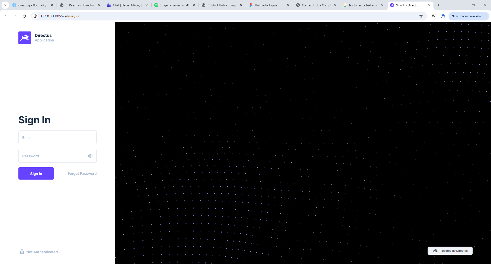

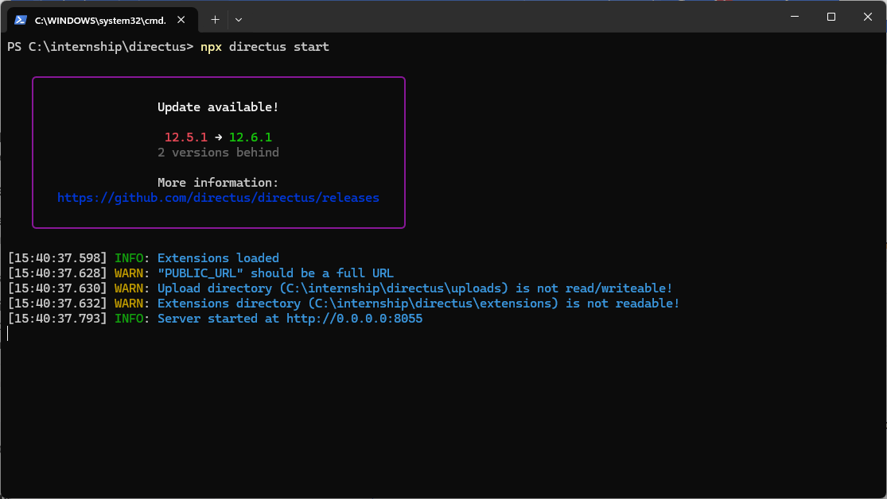

**Installation Method & Database Confirmation:**
- Scaffolded the local Directus project via Node.js CLI using `npx create-directus-project@latest contact-hub-cms` inside `C:\internship`, verified system prerequisites (`node`, `npm`, `git`, `docker`, `quarto`), and started the server on `http://127.0.0.1:8055`.
- Configured the database client as **MySQL** connected to the local MySQL Server (`localhost:3306`, database `internship`, user `root`), confirmed by Directus bootstrapping all system and collection tables into the `internship` database.

**Challenges Encountered:**
1. **Initial MySQL Connection & Missing Environment Variables:** Directus failed to connect to MySQL initially because required database environment variables were missing. Resolved by creating and configuring the `.env` file with the exact MySQL connection parameters (`DB_CLIENT="mysql"`, `DB_HOST="localhost"`, `DB_PORT="3306"`, `DB_DATABASE="internship"`, `DB_USER="root"`, `DB_PASSWORD="internship"`).
2. **Incomplete Schema Migration (`ALTER TABLE directus_settings` Failure):** An interrupted initial startup left partial Directus system tables in the `internship` schema, causing subsequent startup attempts to fail on `ALTER TABLE directus_settings`. Resolved by dropping and recreating a clean `internship` database in MySQL so Directus could execute all migrations cleanly from scratch.

## Task 2 – Design and Create the Collection

Create a collection with the key:

`contact_messages`

The collection must support the requirements below. You must decide the appropriate Directus field type, interface, default value, validation, and whether each field is required.

| Field key | Business requirement |
|---|---|
| `id` | Unique record identifier |
| `full_name` | Sender's name; required |
| `email` | Sender's email address; required and validly formatted |
| `company` | Sender's company; optional |
| `phone` | Sender's phone number; optional |
| `subject` | Message subject; required |
| `category` | One of: Product Information, Technical Support, Sales, General Enquiry |
| `message` | Multi-line message; required |
| `status` | One of: New, In Progress, Resolved; new records default to New |
| `date_created` | Automatically records when the item was created |

Use clear human-readable labels in Data Studio. Add any sensible validation rules that improve data quality without preventing legitimate submissions.

### Required evidence

- Screenshot of the collection and all fields in Data Model
- Screenshots showing the configuration of at least three important fields, including `category` or `status`

#### Answer {.unnumbered}

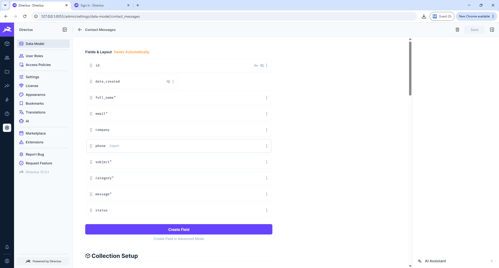

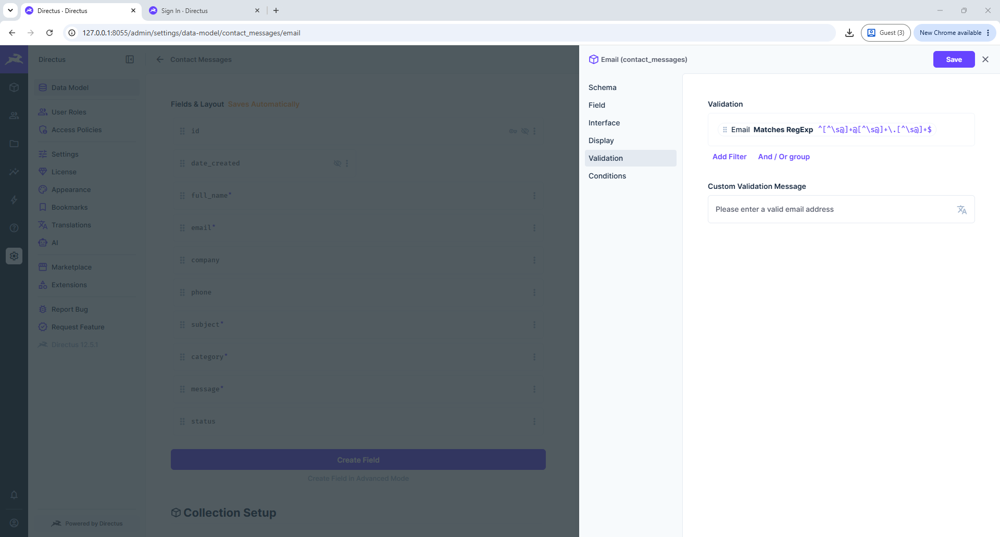

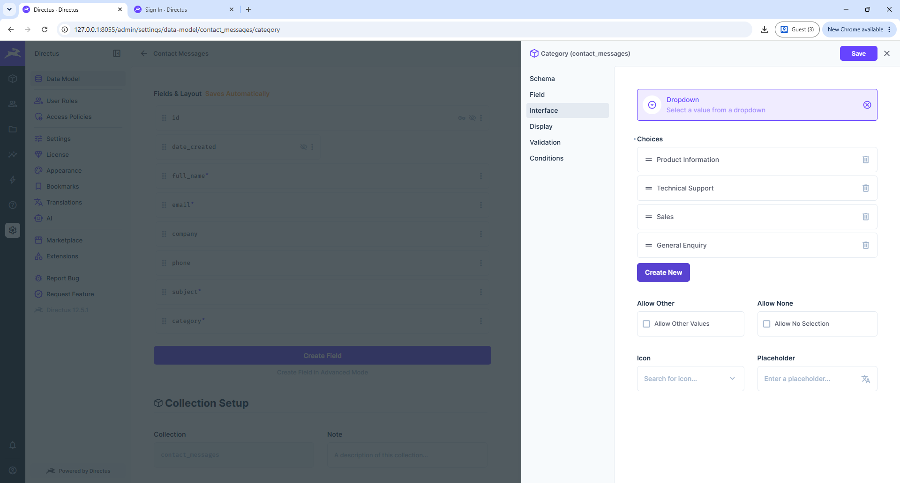

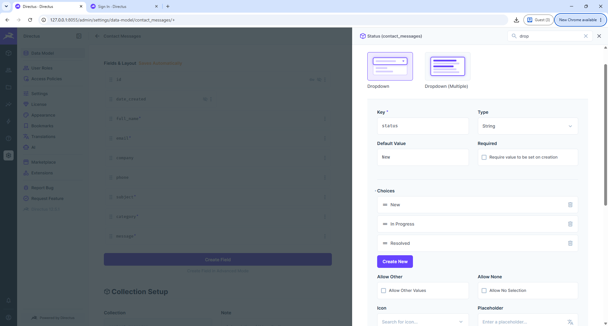

| Field key | Directus Type & Interface | Required | Default | Validation / Options |
|---|---|---|---|---|
| `id` | Generated UUID (Primary Key) | Auto | Auto | Unique primary key |
| `full_name` | String (`input`) | Yes | — | Non-empty sender name |
| `email` | String (`input`) | Yes | — | Regex validation (`^[^\s@]+@[^\s@]+\.[^\s@]+$`) |
| `company` | String (`input`) | No | `NULL` | Optional organization name |
| `phone` | String (`input`) | No | `NULL` | Optional contact phone number |
| `subject` | String (`input`) | Yes | — | Non-empty message subject |
| `category` | String (`select-dropdown`) | Yes | — | Choices: `Product Information`, `Technical Support`, `Sales`, `General Enquiry` |
| `message` | Text (`input-multiline`) | Yes | — | Multi-line message body |
| `status` | String (`select-dropdown`) | Yes | `New` | Choices: `New`, `In Progress`, `Resolved` |
| `date_created` | Timestamp (`datetime`) | Auto | On Create | System-managed creation timestamp |

## Task 3 – Configure Access Safely

Configure the minimum access needed by the React application to:

1. create a contact message; and
2. retrieve the fields required by the message-list component.

You must decide whether public access or an authenticated role is appropriate. Apply least privilege: the browser application must not receive administrator credentials, and website visitors must not be able to update or delete messages.

If your list is accessible without authentication, do not expose private contact fields such as email address and phone number in the list response.

### Required evidence

- Screenshot(s) of the applicable access policy or permissions
- A short explanation of what Create, Read, Update, and Delete access you allowed or denied
- A statement explaining how private data and credentials are protected

> The assessor may ask you to demonstrate that an allowed request succeeds and a disallowed request fails.

#### Answer {.unnumbered}

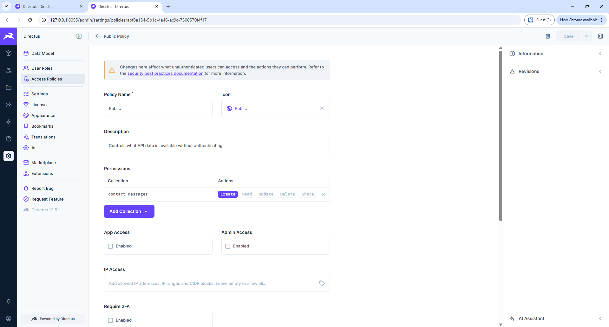

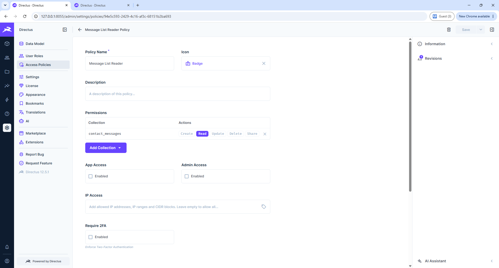

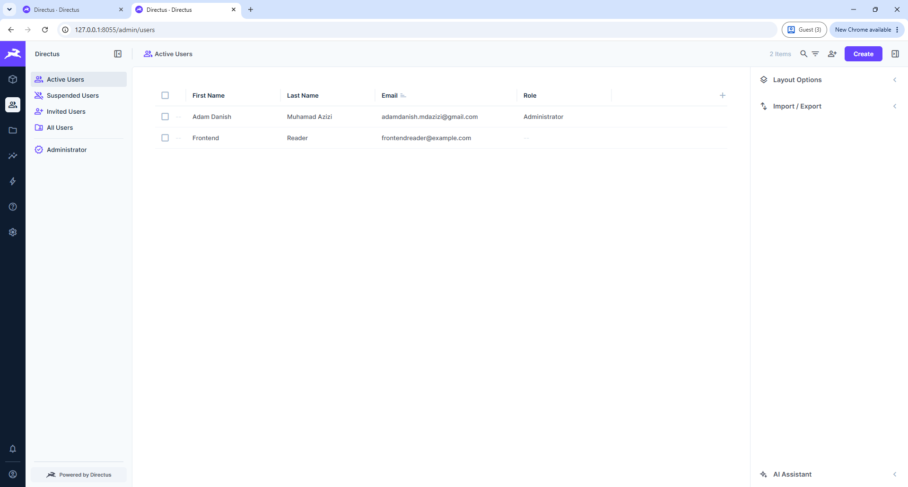

**CRUD Access Explanation:**
- **Public Policy (Anonymous Visitors):**
  - **Create:** Allowed (`All Access`) so visitors can submit the Contact Us form without authentication.
  - **Read:** Denied (`No Access`) so unauthenticated users cannot read or scrape submitted messages or private contact fields (`email` and `phone`).
  - **Update & Delete:** Denied (`No Access`) so visitors cannot edit or delete existing submissions.
- **Message List Reader Policy (Read-Only Service Account):**
  - **Read:** Allowed (`All Access`) on `contact_messages`, queried with explicit non-private fields (`id`, `full_name`, `company`, `subject`, `category`, `message`, `status`, `date_created`).
  - **Create, Update & Delete:** Denied (`No Access`) to enforce strict read-only least privilege.

**Protection of Private Data and Credentials:**
Directus Core gates custom field-level permission masking (*Use Custom* under Read) behind an upgraded license. To protect private `email` and `phone` fields without a commercial tier, unauthenticated `Read` access was completely disabled on the **Public** policy. Instead, a dedicated non-admin service user (`frontendreader@example.com`, with both *Admin Access* and *App Access* disabled) was assigned the read-only `Message List Reader` policy and issued a scoped static API token for the future React frontend. This ensures administrator credentials are never exposed in the browser, visitors cannot update or delete records, and private contact details are omitted from the message-list response.

## Task 4 – Create and Inspect Test Data

Create at least five realistic records covering:

- at least three categories;
- at least two statuses; and
- at least one record created through the Directus API or SDK rather than Data Studio.

### Required evidence

- Screenshot of the populated collection list
- Screenshot of one complete item in Data Studio
- Evidence of the API- or SDK-created item

#### Answer {.unnumbered}

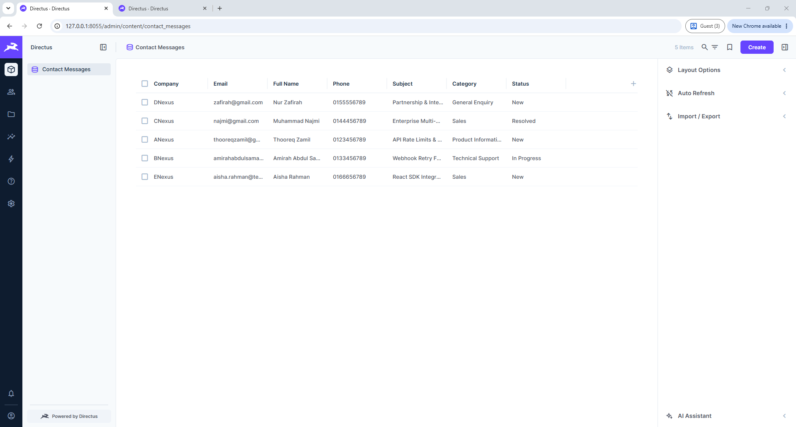

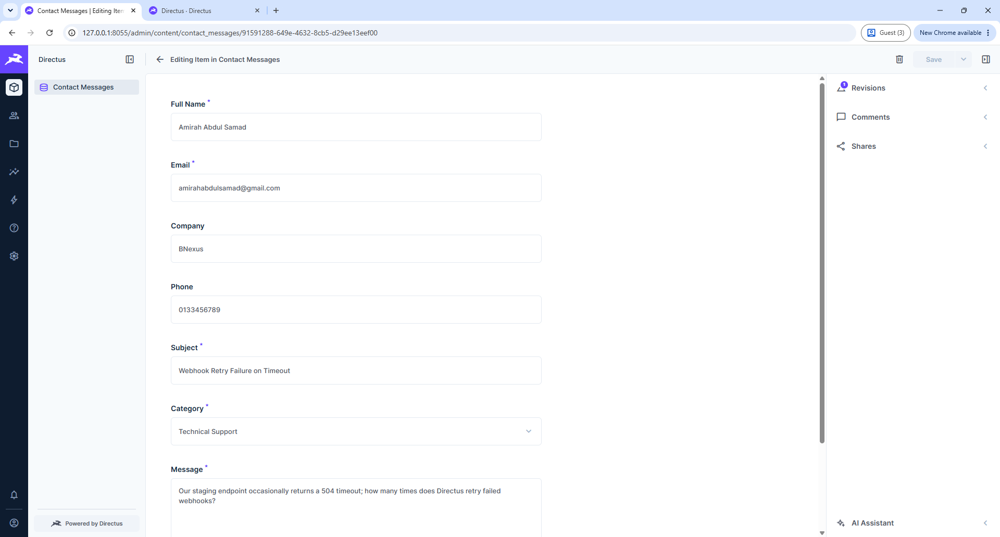

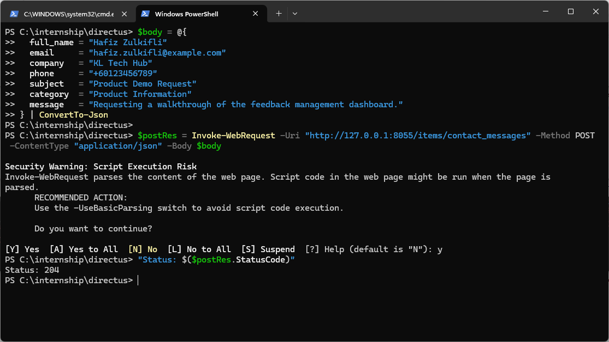

## Task 5 – Verify the Backend

Using a method of your choice, demonstrate that the configured API can:

- return the permitted message fields;
- create a valid message;
- reject or safely handle an invalid submission; and
- prevent an unauthorised update or delete operation.

Record the tool used, request performed, result, and relevant HTTP status code. Do not reveal secrets in the evidence.

#### Answer {.unnumbered}

**Tool & Endpoints Used:** Windows PowerShell (`Invoke-WebRequest`) targeting `http://127.0.0.1:8055/items/contact_messages` (all bearer tokens redacted from evidence).

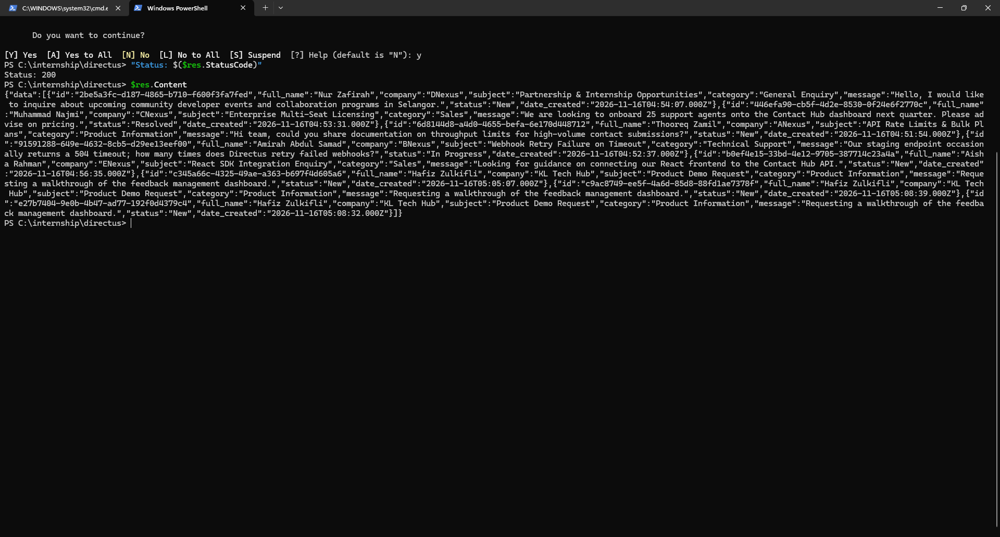

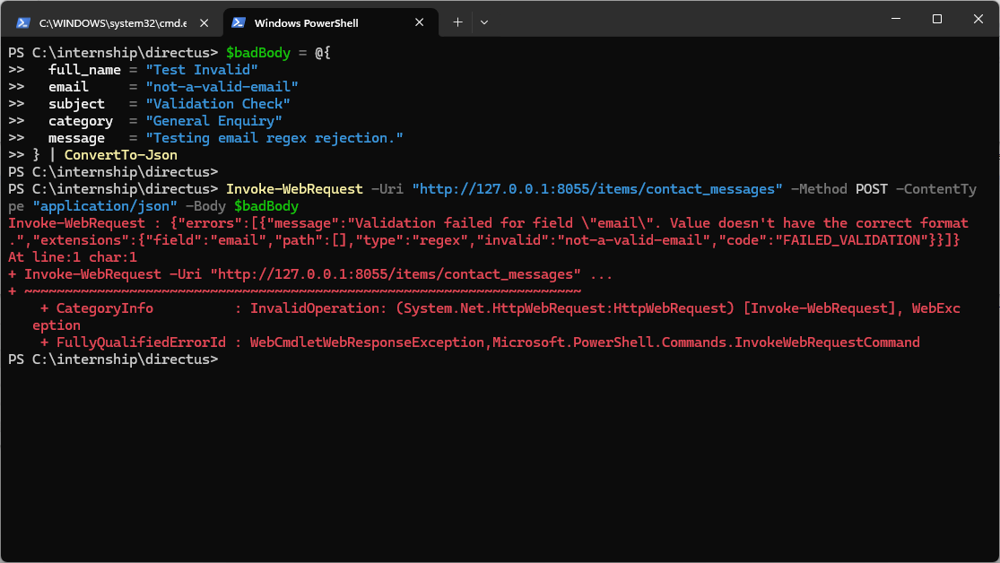

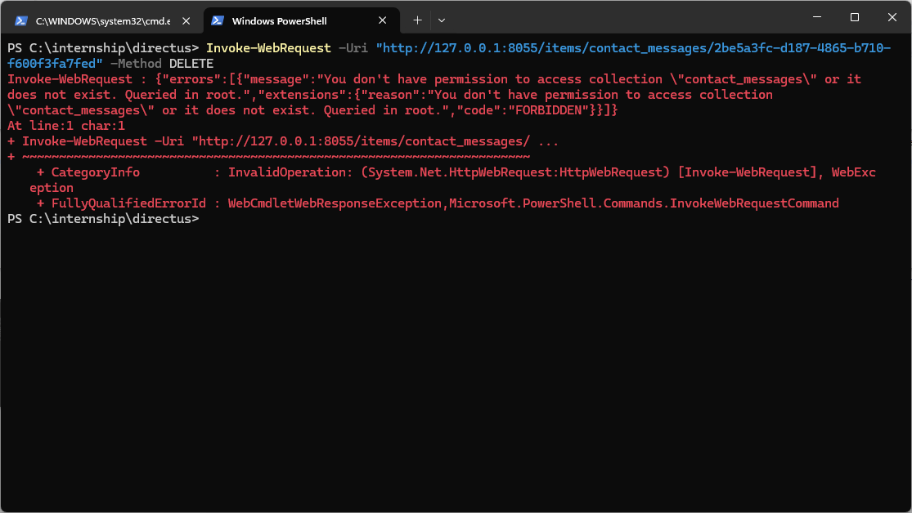

| Test | Expected outcome | Actual outcome | Status code | Pass? |
|---|---|---|:---:|:---:|
| Read messages | Permitted fields returned | `GET` with read-only service token returned JSON containing only the 8 permitted public fields (`email` and `phone` omitted) | 200 | ☑ |
| Create valid message | Record created | Unauthenticated `POST` with valid JSON payload persisted the record in `contact_messages` (empty body returned since Public policy lacks `Read`) | 204 | ☑ |
| Create invalid message | Rejected or validation shown | Unauthenticated `POST` with invalid email (`not-a-valid-email`) rejected with `FAILED_VALIDATION` error | 400 | ☑ |
| Update/delete without permission | Rejected | Unauthenticated `DELETE /items/contact_messages/1` rejected with `FORBIDDEN` error | 403 | ☑ |

**Problems encountered:**
1. **Granular Field Permissions Restricted in Directus Core:** Clicking *Use Custom* under the Public policy's *Read* permission required an upgraded license. Resolved by disabling *Read* on the Public policy entirely (keeping Public as *Create*-only) and creating a separate `Message List Reader` policy paired with a non-admin service user (`frontendreader@example.com`) and scoped static API token.
2. **Email Top-Level Domain Validation:** Directus rejected `.test` domains (`frontendreader@local.test`) when creating the service user; resolved by using `frontendreader@example.com`.

## Directus Deliverables

☑ Running Directus project  
☑ Directus configured with the provided MySQL database  
☑ `contact_messages` collection with configured fields  
☑ Appropriate access policy or permissions  
☑ Five or more records  
☑ Installation, schema, permissions, and API-test evidence  
☑ Short record of problems encountered and how they were resolved