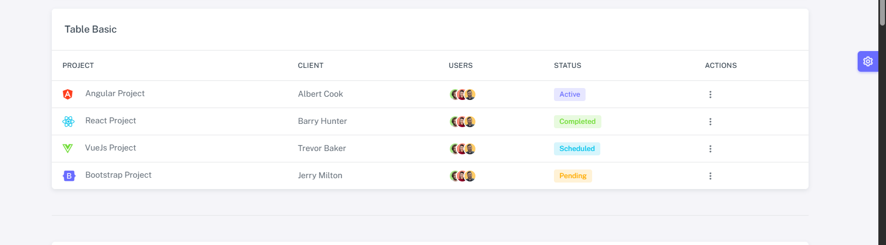
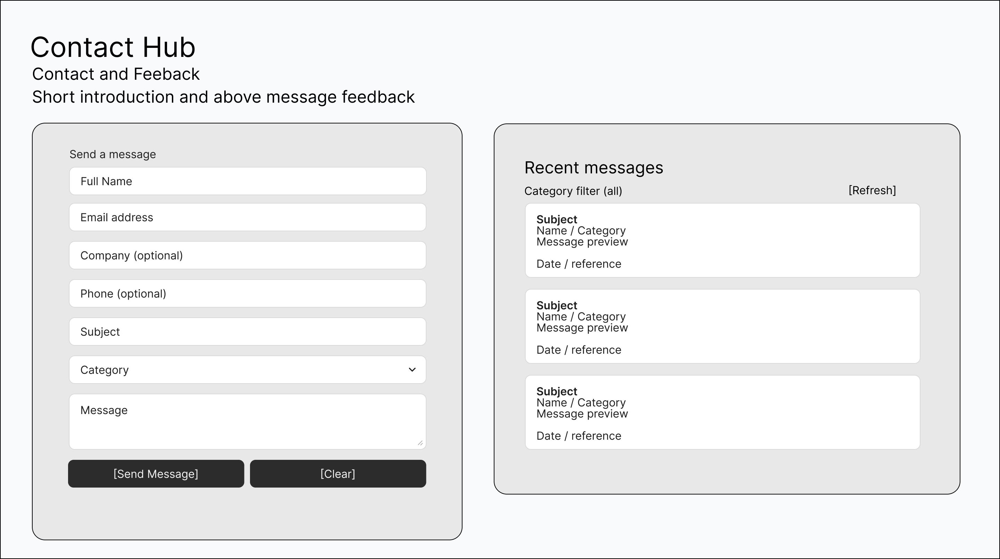

# Contact and Feedback Interface Design (Figma)
---

**Scheduled time:** 1.30PM - 2.30PM

**Primary focus:** A design that can be reproduced as working React components

## Objective

Design a clear Contact and Feedback page for the Directus collection created in the previous chapter. The page must contain two distinct components:

1. a form for submitting a message; and
2. a list for displaying messages retrieved from Directus.

Both components may appear on the same page. Visual polish is useful, but component structure, usability, consistency, and implementability are more important than advanced graphic design.

Sample screenshots are attached.

## Figma Workspace

Use the following figma workspace:

URL: <https://www.figma.com>

Username: facturatie@nts.nl

Password: Seinhuis15_

Log into Figma and confirm that you can access the assigned project. Then create a new design.

## Design Brief

Create a desktop design for a page called **Contact and Feedback**.

### Message form component

Include controls corresponding to:

- Full Name
- Email Address
- Company (optional)
- Phone Number (optional)
- Subject
- Category
- Message
- Submit action
- Clear or Reset action

### Message list component

Design a list, table, or card layout that shows data retrieved from Directus. It should display only fields appropriate for the access model chosen in Chapter 4, such as:

- sender name;
- subject;
- category;
- message or shortened preview;
- status; and
- submission date.

## Task 1 – Wireframe

### Answer {.unnumbered}

**Wireframe Structure & Layout Decisions:**
- **Two-Column Desktop Grid:** Designed a desktop layout titled **Contact Hub** with a page subtitle, separating the **Send a message** form card on the left and the **Recent messages** feed on the right so users can submit inquiries and inspect live records side by side.
- **Message Form Component:** Arranged all required and optional inputs (`Full name`, `Email address`, `Company (optional)`, `Phone (optional)`, `Subject`, `Category` dropdown, and multi-line `Message`) with required indicators (`*`) and paired `Send Message` (primary) and `Reset` (secondary) action buttons.
- **Message List Component:** Structured stacked message cards with a category filter dropdown (`Category Filter: All`), displaying `Subject`, `Category`, `Status` (`New`, `In Progress`, `Resolved`), shortened message preview, sender name (`full_name`), and submission date (`date_created`), while strictly omitting private fields (`email` and `phone`) to match the `frontendreader` access policy from Chapter 4.

## Task 2 – Polished High-Fidelity Design

### Answer {.unnumbered}

## Figma Deliverables

- [ ] Shareable Figma link with appropriate access
- [x] Mockup wireframe (`screenshots/figma-wireframe.png`)
- [ ] Desktop final designs
- [ ] Screenshot of the complete Figma page (`screenshots/figma-polished.png`)