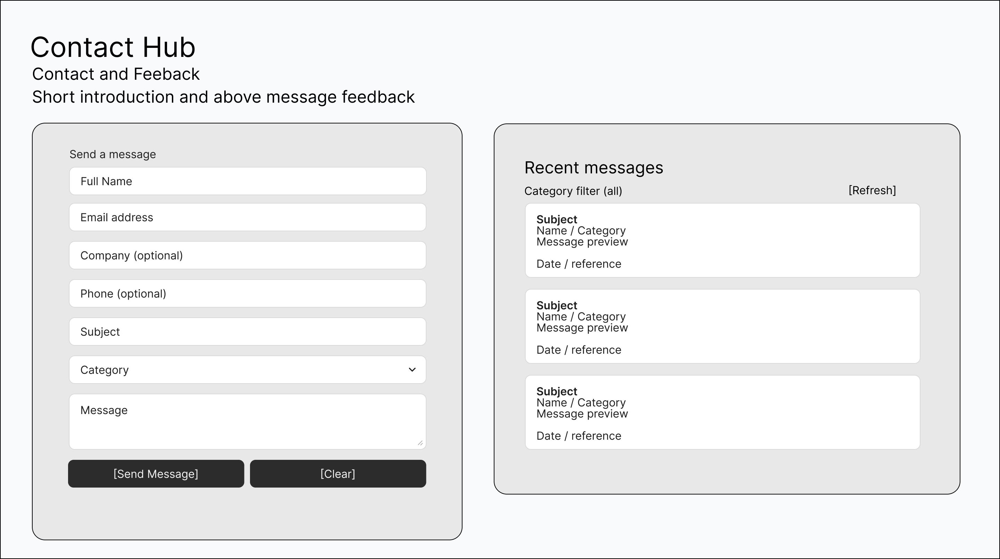
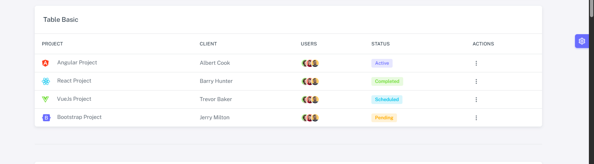

# React and Directus SDK Implementation
---

**Scheduled time:** 2.30PM - 4:30PM 

**Primary focus:** React structure, Directus SDK integration, data handling, and implementation

## Objective

Build the Contact and Feedback application designed in Figma. The application must use React and the official Directus SDK to create and retrieve records from the Directus project configured in Chapter 4.

You must initialise the project yourself. The assessment provides required behaviour, not step-by-step commands.


## Technical Constraints

- Use React. JavaScript or TypeScript is acceptable.
- Use the official `@directus/sdk` package.
- Use the SDK's REST client for reading and creating collection items.
- Store the Directus project URL in an environment variable.
- The application should run using commands documented in its `README`.
- Do not replace the Directus SDK integration with hard-coded sample data or browser-only storage.


## Task 1 – Initialise and Structure the Project

Create a new React project and organise it into sensible components and modules.

Your solution should contain separate responsibilities for:

- Directus client configuration;
- message form;
- message list;
- page-level layout.

Exact filenames and folder structure are your decision. Avoid placing the entire implementation in one component.

### Required evidence

### Answer {.unnumbered}

The project was created with Vite (React, JavaScript) in `contact-hub-frontend`. Responsibilities are separated as follows:

| Responsibility | File |
|---|---|
| Directus client configuration | `src/lib/directus.js` |
| SDK request functions | `src/api/messages.js` |
| Message form | `src/components/MessageForm.jsx` |
| Message list | `src/components/MessageList.jsx` |
| Page-level layout and state | `src/pages/ContactPage.jsx` |


- Screenshot of the application running locally
- Screenshot or text capture of the successful development startup


## Task 2 – Configure the Directus SDK

Create one reusable Directus client configured from an environment variable. Define or document the `contact_messages` data shape used by the frontend.

Demonstrate that your code uses the SDK to:

- read multiple items from `contact_messages`; and
- create a new item in `contact_messages`.

The assessor should be able to find the client configuration and SDK request functions easily during code review.

### Answer {.unnumbered}

One reusable client is created in `src/lib/directus.js`. The Directus URL comes from the environment variable `VITE_DIRECTUS_URL`.

```js
import { createDirectus, rest } from "@directus/sdk";

export const directus = createDirectus(
  import.meta.env.VITE_DIRECTUS_URL
).with(rest());
```

`src/api/messages.js` contains the SDK requests:

- `getMessages()` reads multiple items with `readItems("contact_messages", ...)`, requesting only the permitted fields and sorting by `-date_created`.
- `createMessage(payload)` creates an item with `createItem("contact_messages", payload)`.

### Data shape {.unnumbered}

| Field | Type | Notes |
|---|---|---|
| id | string | Used as the React key |
| full_name | string | Required |
| email | string | Required, validated; not requested by the list |
| company | string or null | Optional |
| phone | string or null | Optional; not requested by the list |
| subject | string | Required |
| category | string | Product Information, Technical Support, Sales, General Enquiry |
| message | string | Required |
| status | string | New, In Progress, Resolved; backend default is New |
| date_created | string | Set automatically by Directus |

### Access {.unnumbered}

Choose one and delete the other.

**Option A (Public role):** Visitors use the Public role, which can create messages and read only the safe fields. It cannot update or delete, so no credential is stored in the browser.

**Option B (read-only token):** Creating messages uses the Public role, which allows create only. Reading uses a dedicated read-only user whose token is stored in `.env`. That user can read only the fields used by the list (not email or phone) and cannot update or delete. The token is visible to anyone who inspects the browser, so for production the read would go through a backend proxy or a public read-only policy.


## Task 3 – Implement the Figma Design

Reproduce your desktop Figma designs in React and CSS. The implementation should include:

- the Contact and Feedback page layout;
- the message form component;
- the message list component;

The final result should be recognisably based on the submitted Figma design.

### Answer {.unnumbered}

The page follows the wireframe: a header, then two cards side by side. "Send a message" is on the left with placeholder-only fields, a dark Send button and a light Clear button. "Recent messages" is on the right with a category filter, a Refresh control and message cards showing the subject, sender and category, a shortened message preview, and the date and reference. The layout is responsive and stacks to one column below 1023px.




## Task 4 – Retrieve and Display Messages

When the page loads, retrieve messages from Directus and display the permitted fields using the designed list component.

Requirements:

- show a visible loading state;
- show an empty state when no records are returned;
- show a useful error state if loading fails;
- order messages newest first;
- format the submission date for people to read; and
- use stable identifiers as React list keys.

Implement at least one useful list control from your Figma design, such as category filtering, status filtering, or sorting.

### Answer {.unnumbered}

`ContactPage` calls `getMessages()` when the page loads and passes the result to `MessageList`.

- **Loading state:** "Loading messages..." is shown while the request runs.
- **Empty state:** "No messages found" is shown when no records match.
- **Error state:** the error from the SDK is shown in an alert.
- **Order:** newest first, using `sort: ["-date_created"]` in the request.
- **Date:** formatted with `toLocaleDateString`, for example Nov 16, 2026.
- **Keys:** each card uses `item.id` as its React key.
- **List control:** a category filter, plus a Refresh button.




## Task 5 – Create Messages

Connect the form to Directus using the SDK.

Requirements:

- use controlled form fields or another clearly explained React form approach;
- validate required fields and email format before submission;
- prevent duplicate submissions while a request is in progress;
- display a submission error without losing the user's entered data;
- display success feedback after a successful submission;
- clear the form only after success; and
- update the visible message list without requiring a full browser refresh.

The values sent by the form must match the collection field keys and category choices configured in Directus. The backend default should be used for `status` unless you justify another secure approach.

### Answer {.unnumbered}

`MessageForm` uses controlled inputs held in React state.

- **Validation:** Full Name, Email, Subject and Message are required, and the email format is checked before submission. Errors appear inline under the fields.
- **Duplicate submissions:** the Send button is disabled while a request is in progress.
- **Errors:** if the request fails, an error is shown and the entered data is kept.
- **Success:** a "Message sent" confirmation appears, and the form is cleared only after success.
- **List update:** after a successful create, the page reads the messages again, so the new item appears without a browser refresh.
- **Payload:** the keys match the Directus field keys and category choices. `status` is not sent, so the backend default (New) applies.


## Task 6 – Code Quality and Configuration

Your application should:

- use meaningful names;
- avoid unnecessary duplication;
- include an `.env.example` containing placeholder configuration; and
- include a concise `README` with setup, run, build, and configuration instructions.

### Answer {.unnumbered}

- Components, functions and variables use descriptive names.
- The category list and SDK requests are defined once and reused.
- `.env.example` contains the placeholder `VITE_DIRECTUS_URL=http://localhost:8055`. The real `.env` is excluded from Git.
- `README.md` documents installation (`npm install`), running (`npm run dev`), building (`npm run build`) and configuration.
---

## React Deliverables

☐ Complete React source code  
☐ Working Directus SDK client  
☐ Responsive form and list matching Figma  
☐ Read and create operations working against Directus  
☐ Setup and run instructions in `README`  
☐ Screenshots of desktop results


